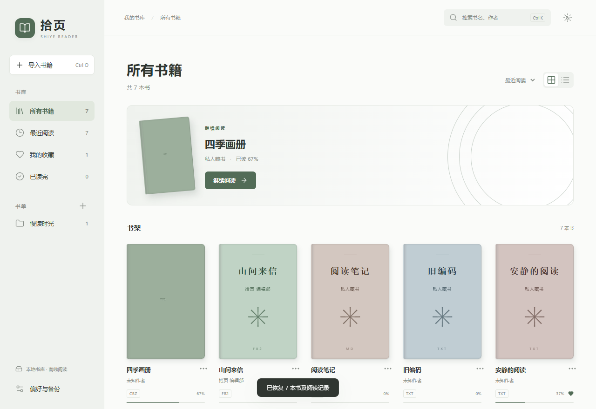

# 拾页 · Shiye Reader

轻量、简洁的 Windows 本地阅读器。支持 EPUB、PDF、TXT、Markdown、FB2 与 CBZ，采用 WebView2 与本地书库。



## 下载与使用

下载 Windows x64 免安装包，解压后双击 `拾页.exe`。可以将软件放在 D 盘等空间充足的位置。[下载最新版](https://github.com/xuxujunjbhjvhvc/shiye-reader/releases/latest)

运行环境为 Windows 10 / 11 x64、.NET Framework 4.8 和 Microsoft Edge WebView2 Evergreen Runtime。

点击“导入书籍”，或将文件拖入书库。原书副本、进度、书签和缓存保存在软件旁的 `Data` 文件夹。

## 阅读交互

- 顶部“翻页 / 滚动”可随时切换，所选模式会自动记忆。
- 翻页模式下，点击正文左右留白，分别翻到上一页和下一页，也可使用方向键。
- EPUB 支持连续滚动，PDF 和 CBZ 按需加载相邻页面，文本类书籍支持正文分页。
- 切换模式时保留当前阅读位置，历史书库中的阅读进度继续可用。
- 正文区域支持文字选择，目录和搜索结果可以定位到对应内容。

## 书库与外观

封面和列表视图、书名与作者搜索、排序、收藏、自建书单、目录、书签、阅读进度、全书搜索与全屏。

提供纯白、纸白、暖黄和深夜主题。EPUB 与文本类书籍支持字体、字号与行间距设置。PDF 支持缩放与文字选择。扫描 PDF 的文字搜索依赖文件中的文本层。

“偏好与备份”可以将原书、书单、书签和进度导出为 ZIP。恢复时按书籍 ID 合并，同一本书采用备份记录。单本导入上限为 512 MB。

## 快捷键

| 快捷键              | 操作                   |
| ------------------- | ---------------------- |
| Ctrl O              | 导入书籍               |
| Ctrl K              | 搜索书库               |
| Ctrl F              | 书内搜索               |
| ← / →               | 上一页 / 下一页        |
| Page Up / Page Down | 翻页                   |
| Esc                 | 关闭阅读侧栏或返回书库 |
| F11                 | 全屏                   |

## 本地开发

需要 Node.js 22+ 和 npm。

```powershell
npm ci
npm run dev
```

浏览器开发入口使用本地 IndexedDB 保存测试书库。桌面版使用软件旁的 WebView2 数据目录。

## 构建 Windows 免安装版

在 Windows PowerShell 中执行，构建文件默认输出到 `release/拾页`。

```powershell
npm run package
```

构建脚本会安装前端依赖、打包离线资源、下载所需 WebView2 SDK，并调用系统的 .NET Framework C# 编译器。构建缓存位于项目中的 `.build` 目录。

也可指定现有安装目录，更新时继续使用该目录内的 `Data` 书库。

```powershell
powershell -NoProfile -ExecutionPolicy Bypass -File native/Build.ps1 -OutputDirectory "D:\Apps\拾页"
```

## 测试

仓库中的 EPUB、PDF 和文本测试书籍均为本项目原创测试内容。

```powershell
npm ci
npx playwright install chromium
npm run build
npm test
npm run package
npm run test:native
```

可通过 `PLAYWRIGHT_CHROMIUM_EXECUTABLE` 指定本机 Chromium，通过 `SHIYE_PACKAGE_ROOT` 指定原生测试的成品目录。

## 技术与许可

前端使用 Vite、EPUB.js、PDF.js、JSZip、DOMPurify、Marked 和 Lucide。桌面宿主使用 C# WinForms 与系统 WebView2。

项目采用 MIT 许可证。第三方组件的许可文本位于 `licenses` 目录。WebView2 SDK 适用微软随附的许可条款。
